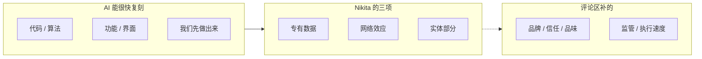

> 参考：https://x.com/nikitabier/status/2109497987055640958

## 核心内容

2026 年 10 月 12 日 15:14（墨尔本时间），Nikita Bier 发了一条很短的帖。讲解页抓取时大约 1.25 万赞、970 转发、344 条引用、6100 收藏、66 万浏览，下面还有 595 条回复。收藏和赞的比例很高，很多人是把它当创业检查清单存下来的。

> Technical moats are mostly over at this point. If you’re building something that is meant to be durable, the only moats now are:
>
> • Proprietary data
> • Network effects
> • A physical component

[原帖](https://x.com/nikitabier/status/2109497987055640958)。翻译过来：技术护城河差不多结束了。想做能长久的东西，现在只剩三种护城河：专有数据、网络效应、实体部分。

这句话有分量，是因为他是谁。他做过两个被收购的青少年社交 app，tbh（Meta 收购）和 Gas（Discord 收购），后来当过 X 的产品负责人。抓取时他的简介是「unemployed. former head of product @x」。他上 [Lenny's Podcast](https://podcastnotes.org/lennys-podcast-with-lenny-rachitsky/nikita-bier-how-to-consistently-go-viral-the-playbook-for-winning-at-consumer-apps-lennys-podcast/) 讲的也是社交图谱和增长测试。清单里两项都是消费级社交的老逻辑，不是一份中立的行业普查。

原帖没有解释这三项。595 条回复和 344 条引用把清单拆开，争的是护城河到底是名词还是动词。

我的判断写在后面：Nikita 对了一半，Eno Reyes 对了另一半。消失的是技术领先的速度；专有数据、网络效应和实体部分也不会因为握在手里就自动生效。护城河要持续挖。

## 要点整理

### 三条护城河各自防什么

讲解页里那张动画图搬不进 markdown。左栏是 AI 能很快复刻的东西，右栏实线是原帖的三项，虚线是评论区补得最多的几项。补项大多是人和关系，不是技术。

原帖把三项并列，好像它们是同一类耐久资产。评论区的攻和补说明它们不是。

**专有数据**：别人没有的原料。Eno Reyes（Factory AI 的 CTO）的反例是四大会计所和 Ramp。原话是讽刺：有专有数据，所以四大打赢了 Ramp——哦等一下，并没有。帖子没有证明「他们有数据但不用」。能确定的只有：专有数据没有自动变成胜势。

**网络效应**：用的人越多，越难被换掉。这是 Nikita 自己的主场。Eno 的反例是 GitHub：有开发者网络，所以它赢了 AI 编程——也没有。网络还在，下一场的赢家可以换人。

**实体部分**：原子比代码难隔夜复制。Eno 的反例是国防：有实体部分，所以不会有新的国防承包商——照样有。实体挡住的是纯软件式的抄袭，挡不住愿意碰原子的新进入者。

三条放在一起，Eno 的结论是：

> Proprietary data which is why big 4 accounting firms beat ramp - oh wait
>
> Network effects which is why Github won AI software dev - oh wait
>
> Physical component which is why there are no new defense contractors - oh wait
>
> There is no moat. You are defenseless and also can win it at all at the same time. Act accordingly.

[Eno Reyes 的引用帖](https://x.com/EnoReyes/status/2109540083284267356)。讲解页抓取时 424 赞、166 收藏，是引用里讨论最热的一条。

### 评论区的三派

**第一派：对，而且早该说了。** levelsio 引用原帖只有一句：

> Even Nikita says it

[引用帖](https://x.com/levelsio/status/2109524844056543523)，讲解页抓取时 880 多赞。同一天他回了一句，可见正文是：

> People feel threatened and they think my point is doom and I'm a doomer
>
> I'm not, there's an explosion of creativity if anyone can make their own personal software
>
> It'll just be a completely different paradigm I think

[这条回复](https://x.com/levelsio/status/2109545183876616408)。他不是在唱衰。门槛没了，任何人都能做自己的个人软件，这是创造力的爆发，也是另一套范式。讲解页还提到他前一天发过「Software is dead，现在是个人软件的时代」，但没有给出那条帖的链接。

hxiao 的引用帖正文只有：

> Yes, moat is gone, but also this:

[引用帖](https://x.com/hxiao/status/2109507980714742072)。后面是一张经典梗图。讲解页对图的说明是：绝大多数人不敢试、失败三次就放弃、太慢、被新东西分心，最后只剩「你和另一个人」。护城河没了，坚持本身还在筛人。

**第二派：清单漏了。** 数量最多，补的东西很集中。

品牌和监管：

> Agreed technical moats are basically dead. Only others I’d add:
>
> 1) Brand aka trusted distribution
> 2) Regulatory positioning

[businessbarista 的引用帖](https://x.com/businessbarista/status/2109601795765121259)。品牌在这里被定义成可信的分发，不是 logo。监管是这组里的例外：它是位置，不是个人创作者挖得出来的关系。

已经挣到的信任：

> I'd add earned trust.
>
> A business may be able to copy your screens quickly. Convincing a customer to move years of records, retrain staff and rely on a new provider is a different job.

[AskMichaelTaiwo 的引用帖](https://x.com/AskMichaelTaiwo/status/2109601222407889096)。界面可以抄，多年的记录、重新培训、以及客户愿不愿意把事交给你，抄不走。

品味和判断。讲解页只摘了前两段，回复全文是：

> IMO, you missed the ones that actually compound: Taste and Judgement.
>
> When intelligence is abundant, execution commoditizes. The moat shifts to knowing what to build and what to leave out.
>
> Taste sets the direction. Tight feedback loops refine your judgment. Done consistently, that loop produces the only thing capital cannot replicate overnight: earned trust.

[Anoop Kumar Bhat 的回复](https://x.com/AnoopKumarBhat/status/2109603146393923823)。智能变便宜之后，执行变成大路货。复利的是：品味定方向，短反馈改判断，最后变成资本一夜复制不了的 earned trust。这和上面的品牌、信任是同一件事的三段，不是三个新名词。

执行速度，作者自己标成弱项：

> Totally agreed.
>
> And for now, pace of execution and shipping. Not sure it compounds but it is a (weak) moat for now

[rsarver 的引用帖](https://x.com/rsarver/status/2109602955494113447)。快能拉开一段距离。他没说这段距离会自己留下来。

**第三派：护城河这个名词不成立。** Eno 的帖在上面。Roy Shilkrot 把「这不是新闻」说完整了。讲解页只摘了最后一句，全文是：

> I can’t see why this is news to anyone today since it’s always been the case.
> Any tech is (and was) on a path to commoditization.
> The only thing that did change is the speed at which competition can catch up.
>
> Moats are dug with picks and shovels, not bits and bytes.

[Roy Shilkrot 的引用帖](https://x.com/RoyShilkrot/status/2109606053549834346)。技术一直在走向商品化。变的是对手追上来的速度。护城河是镐和铲挖出来的，不是比特本身。

还有一段插曲。有人回：

> What's even left to build at this point lmao

[latentfidelity 的回复](https://x.com/latentfidelity/status/2109498908854583296)。Nikita 回了一张购物车截图，当黑色幽默，讲解页抓取时 1000 多赞（[这条回复](https://x.com/nikitabier/status/2109502507961766123)）。讲解页说这是他在讨论串里唯一的回复：他没有下场答 Eno，也没有改那张清单。

### 对得上的地方，和各自漏的地方

| 立场 | 技术还是不是护城河 | 还剩什么 | 漏掉的一半 |
| --- | --- | --- | --- |
| Nikita | 基本不是 | 专有数据、网络效应、实体部分 | 有资产不等于它在起作用；清单带着消费社交的出身 |
| 补项的人 | 同意技术护城河死了 | 品牌、信任、监管、品味；执行速度只是眼下的弱项 | 监管个人选不了；执行速度作者自己说不一定复利 |
| levelsio / hxiao | 同意，而且当好消息 | 个人软件的创造力；还在做的人会把大多数人筛掉 | 没回答「积累的东西会不会过期」 |
| Eno | 连另外三条也不是自动的护城河 | 你既毫无防御，又随时能赢 | 「没有护城河」容易被听成不用积累；反例否定的是拥有即防御 |
| Roy | 技术商品化不是新闻 | 镐和铲，也就是持续挖 | 把速度说清楚了，但没有往下说个人还能挖什么 |

### 我的判断

1. **「技术不再是护城河」这半句是对的，而且不新。** Roy 的原文已经说完了：技术一直在商品化，新的是追赶速度。以前抄一个产品要一个团队几个月，现在一个 cloud agent 一晚上。护城河这个词还在，技术领先的半衰期被压短了。rsarver 把执行速度叫成弱护城河，和这件事是同一面：你跑得快，别人用 agent 也能跑得快，拉开的距离会过期。

2. **Nikita 的三项偏窄。** 专有数据和网络效应是他做了一辈子的那种产品的逻辑，实体部分是另一类生意。评论区补上来的品牌、信任、品味，几乎都是人和关系。Anoop 把它们收成一个环：品味定方向，反馈改判断，最后是资本一夜复制不了的信任。对一个人或一个小团队，专有数据和网络效应很难砸钱买到，只能靠时间攒。监管是清单上的例外，不是这条路径。

3. **Eno 对的那一半**：护城河是动词。四大的数据没有变成对 Ramp 的胜势，GitHub 的网络没有变成 AI 编程的胜势，国防的实体部分没有挡住新公司。握在手里却没有变成胜势，就等于没有。所以「你既毫无防御，又随时能赢」比任何清单都接近现场。levelsio 说这不是唱衰，而是个人软件的创造力爆发。在位者守不住的那个缺口，就是局外人进得来的地方。

护城河不是你拥有的东西，是你每天在挖的东西。

这句是我的概括，不是谁的原话。hxiao 那张梗图说的是同一件事：门槛消失之后，筛子变成谁还在做。

## 对个人开发者意味着什么

我自己在带一个 AI bot 团队，也在做粉丝社群。这条帖子读起来近，是因为我站在「技术护城河没了」的另一边：用 cloud agent 一晚上把东西做出来的人，就是 Eno 说的那个随时能赢、也毫无防御的人。

个人开发者和独立创作者够得着的，通常不是砸钱买来的数据和网络，而是评论区补的那一环。

1. **实现不是壁垒。** bot 团队的代码，别人用 agent 也能写出来。抄不走的是社群里的人，以及他们问的问题。这是一个很小的网络效应，加上一份专有信号：读者到底卡在哪。选题从这里来。

2. **公开写、持续发，就是可信的分发。** businessbarista 的第一项就是这件事。读者愿意看，多半不是因为观点别人想不到，而是因为相信作者真的跑过：多 bot 团队怎么分工，哪类任务交给 agent 能成，哪类会翻车。这份记录越具体越难抄。它就是专有数据，也是 Anoop 说的那种资本一夜复制不了的信任。

3. **做一个给别人用的 agent 产品，领先不要寄托在代码上。** levelsio 那句成立：任何人都能做自己的个人软件。能留下来的是用的人，和跑出来的记录。代码会过期，记录会留下。

如果明天有人把整套做法原样复制走，他还缺什么，才能做出同样的效果？缺的那部分，就是该每天挖的地方。

## 相关链接

- [Nikita Bier 原帖](https://x.com/nikitabier/status/2109497987055640958)
- [讲解页](https://files.joyehuang.dev/notes/moats-after-ai.html)
- [Lenny's Podcast 笔记：Nikita Bier 谈消费级 app 的增长](https://podcastnotes.org/lennys-podcast-with-lenny-rachitsky/nikita-bier-how-to-consistently-go-viral-the-playbook-for-winning-at-consumer-apps-lennys-podcast/)
- [levelsio：Even Nikita says it](https://x.com/levelsio/status/2109524844056543523)
- [levelsio：个人软件是创造力的爆发](https://x.com/levelsio/status/2109545183876616408)
- [hxiao：moat is gone, but also this](https://x.com/hxiao/status/2109507980714742072)
- [businessbarista：品牌与监管](https://x.com/businessbarista/status/2109601795765121259)
- [AskMichaelTaiwo：earned trust](https://x.com/AskMichaelTaiwo/status/2109601222407889096)
- [Anoop Kumar Bhat：品味、判断和信任](https://x.com/AnoopKumarBhat/status/2109603146393923823)
- [rsarver：执行速度是弱护城河](https://x.com/rsarver/status/2109602955494113447)
- [Eno Reyes：There is no moat](https://x.com/EnoReyes/status/2109540083284267356)
- [Roy Shilkrot：镐和铲](https://x.com/RoyShilkrot/status/2109606053549834346)
- [latentfidelity：What's even left to build](https://x.com/latentfidelity/status/2109498908854583296)
- [Nikita 的购物车回复](https://x.com/nikitabier/status/2109502507961766123)
